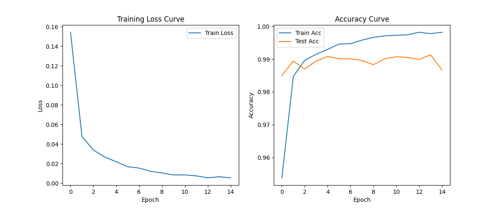
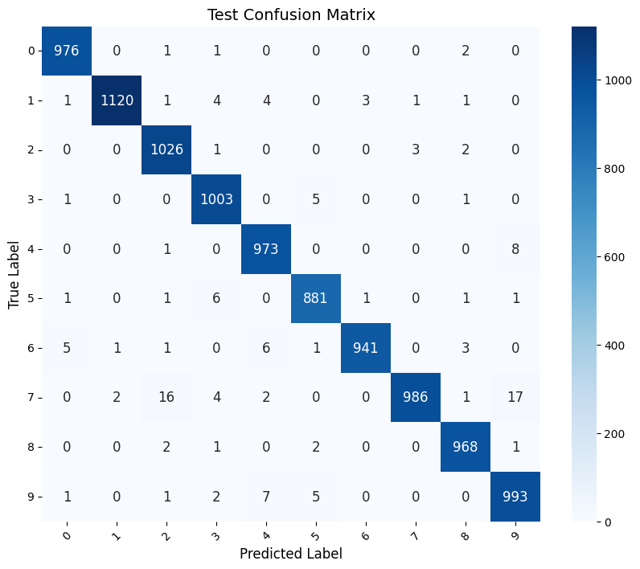
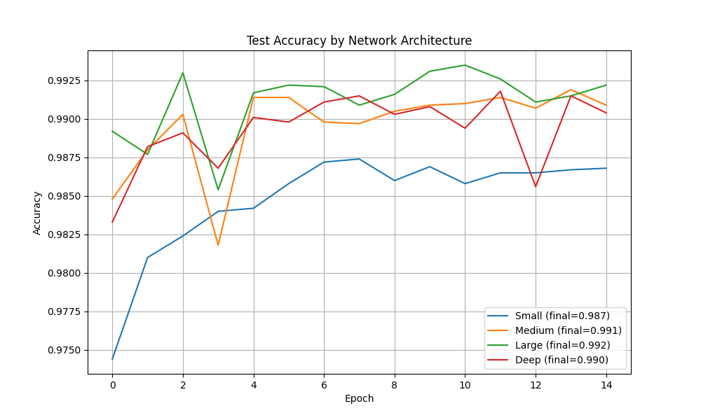

# MNIST Pattern Recognition

使用两种经典路线完成 MNIST 手写数字识别的课程实验：

1. **贝叶斯方法**：Gaussian Naive Bayes + 核密度估计（KDE）+ PCA 降维；
2. **深度学习方法**：PyTorch CNN，包含网络结构、学习率和训练数据量对比实验。

MNIST 数据集由脚本自动下载，不把数据集提交到仓库。

## 结果预览







## 主要结果

| 实验 | 最佳配置 | 测试准确率 |
|---|---|---:|
| CNN 基础模型 | 15 epochs, lr=0.001 | 约 99% |
| 网络结构对比 | Large CNN | 99.22% |
| 训练数据量对比 | 60000 samples | 99.01% |
| 学习率对比 | lr=0.001 | 99.14% |
| 贝叶斯方法 | PCA + Gaussian/KDE | 见结果摘要 |

更完整的结果位于 `docs/results/`。

## 方法

### 1. 贝叶斯分类

`src/bayes_kde.py`：

- 使用 PyTorch 的 MNIST Dataset/DataLoader 读取并展平图像；
- 对零方差特征做 PCA；
- 测试不同 PCA 维度；
- 实现 Gaussian Naive Bayes；
- 实现基于 `KernelDensity` 的自定义贝叶斯分类器；
- 输出训练集/测试集混淆矩阵和维度-准确率曲线。

### 2. CNN 分类

`src/cnn_mnist.py`：

- 两层卷积 + 池化 + 全连接层；
- CrossEntropy Loss + Adam；
- 记录训练损失、训练准确率和测试准确率；
- 生成性能曲线、混淆矩阵和分类报告；
- 支持 CPU / CUDA。

## 快速开始

```powershell
python -m venv .venv
.\.venv\Scripts\Activate.ps1
pip install -r requirements.txt
```

运行贝叶斯实验：

```powershell
python src/bayes_kde.py
```

运行 CNN 实验：

```powershell
python src/cnn_mnist.py
```

首次运行会自动下载 MNIST 到 `data/`。GPU 环境会自动使用 CUDA，否则使用 CPU。

## 项目结构

```text
mnist-pattern-recognition/
├─ src/
│  ├─ bayes_kde.py
│  └─ cnn_mnist.py
├─ docs/
│  ├─ images/
│  └─ results/
├─ requirements.txt
└─ README.md
```

## 说明

- 训练集准确率接近 100%，测试集约 99%，需要结合测试集指标判断泛化能力。
- KDE 在 784 维原始像素上计算量较大，实验中通过 PCA 降低维度。
- 仓库不包含 MNIST 数据、虚拟环境和实验生成目录。
